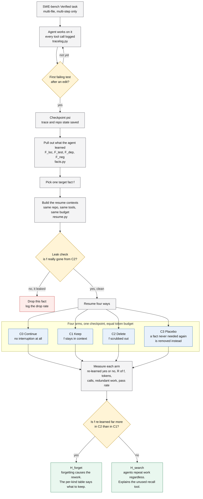
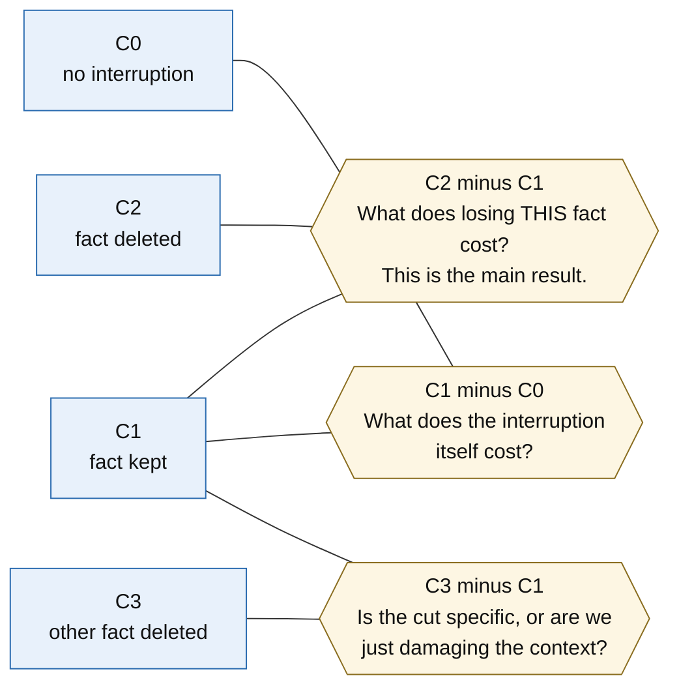

# Does Forgetting Cause Rework? A Study of Context Loss in Coding Agents

Paper target: ICSE 2027 NIER.

Deadline: Friday 23 Oct 2026, 23:59:59 AoE (UTC−12). Submit at https://icse2027-nier.hotcrp.com/

Rules: 4 pages of main text. Figures, tables and appendices count in those 4 pages. One extra page for references only.
IEEE conference template. Double-anonymous. Must have a section called "Future Plans".

This is the plan to follow. Written 2026-10-20. If you need to change it, use the fallbacks in section 11.

---

## 1. What this paper says

People have already counted how often coding agents redo work. Nobody has shown why.

Our question:

> When a coding agent repeats work, is it because it forgot, or because it never knew?

We test it directly. We stop the agent part way through a task. We delete one fact it already learned. We keep
everything else the same, including the token budget. Then we measure what that one deletion costs.

This question is open. Three papers assume different answers. That is our opening.

Section 5 has a diagram of the whole flow.

---

## 2. What is already taken

Do not pitch any of these. Other papers own them.

| Claim                                                             | Who owns it                                                                                                                                                                                                                                                                                          |
|-------------------------------------------------------------------|------------------------------------------------------------------------------------------------------------------------------------------------------------------------------------------------------------------------------------------------------------------------------------------------------|
| Context budget crossed with memory type                           | Harness Design (arXiv:2609.20804). 176 runs. 5 memory strategies, 4 budgets, 4 models, 2 benchmarks. Managed agents beat unmanaged by 35.7 points at 32K, but only 2.7 points at 128K.                                                                                                               |
| Counting repeated work and wasted tokens                          | How Do AI Agents Spend Your Money? (arXiv:2604.22750). 8 models on SWE-bench Verified. Counts repeated file reads and repeated edits. About half of all file actions are repeats in the costly models. A blog study also reports 42% of tokens going to repeated reads, but it is not peer reviewed. |
| Telling apart "was it stored", "could it be found", "was it used" | Delivery, Not Storage (arXiv:2607.20972).                                                                                                                                                                                                                                                            |
| Cutting context and then resuming                                 | Delivery, Not Storage. 138 cut-and-resume cycles. 39% of reads were re-reads. It saw agents grep old session files to rebuild lost facts.                                                                                                                                                            |

What is left is the cause. And the papers disagree about it.

- arXiv:2604.22750 sees the repeated work. It blames bad searching by the agent. It never mentions memory, forgetting,
  or context loss.
- arXiv:2607.20972 blames memory. But it used one task. No control run. It did not test any other explanation. One
  author, no listed university.
- arXiv:2609.20804 argues against the memory story. They gave agents a tool to fetch any dropped context back, exactly
  and losslessly. Agents ignored it. 56% of runs never called it once. The average effect was −0.36 points. The facts
  were saved and findable. Agents re-read files instead. Nobody measured that re-reading.
- SWE-MeM (arXiv:2606.28434) points the other way again. They removed its memory tool at a 256K window and scores got
  worse, 43.4% down to 37.6%. So dropping context sometimes helps.
- Xiong et al. (ACL 2026, 2026.acl-long.27, pp. 623-645) studies memory of past finished tasks, not memory inside one
  task. They say inside-task memory is out of scope. We cite that line. It is a published paper saying our area is open.
  Also cite their result that a plain LLM judge can be worse than no judge at all. 300 training examples fixed it. That
  is why we avoid judges in section 7.

Our claim, stated carefully: we are the first to isolate the cost of losing one specific fact in a real repo task. We
are also the first to test the memory explanation against the bad-search explanation.

---

## 3. Words we use

**Acquired fact** `f`. Something the agent clearly learned during the run. Each one has a source: the exact tool call
and output that taught it. Four kinds:

- `F_loc`. Where something lives. A symbol is in this file, at these lines.
- `F_test`. A test result. Test T fails at line L on this assertion.
- `F_dep`. An interface. The signature of a function the agent read.
- `F_neg`. What did not work. An edit that was reverted, or one followed by a failing test.

**Re-learn signal.** A fixed rule over later tool calls. It fires when the agent gets fact `f` again.

**Re-learn cost** `R(f)`. Tokens and tool calls from the restart until the agent gets `f` back.

**Deletion effect** `Δ(f)`. This is the number we care about. It is `cost(C2) − cost(C1)`. That is the cost of resuming
without the fact minus the cost of resuming with it, at the same token budget. We measure it in tokens, tool calls and
wall clock time. We always report the pass rate next to it.

**Memory debt.** The total of `Δ` across facts. We keep this as a casual name. It is not our novelty claim.

---

## 4. The two questions we answer

These are the supervisor's framing, adopted on 2026-10-21. They are broader and better than what this
section said before, which asked only whether the agent goes back for the one fact we deleted.

**RQ1. Does deleting context change behaviour at all?** Not one number. A vector: which tools get called
and how often, steps, tokens, tool time, whether the task was solved, and whether it broke tests that used
to pass. Needs a significance test, not an eyeball.

**RQ2. If it changes, where?** In the tools it calls, in task failure, in cost, or in which kind of fact was
lost. Two questions is enough for a NIER paper.

Both answers make a paper. There is no result here that wastes the submission.

### What we used to test, and why it was demoted

The old primary measure asked whether the agent goes back and re-acquires the exact fact we deleted. The
pilot killed it. In the first complete four-arm run the agent went back for the location in **both** arms,
including the one where the fact was still in its context. The signal does not measure "went back because it
forgot". It measures "went back", full stop.

That is itself a finding, and it lines up with arXiv:2609.20804, where agents ignored a perfect recall tool
and re-read instead. So we keep it as a secondary measure and report it, but the cost vector in RQ1 is the
primary.

### Written down before looking at results

- H_kind. The effect is strong for some kinds of fact and absent for others. The most likely outcome. We
  expect `F_neg` and `F_test` to cost the most.
- H_negative. Some deletions make the agent do better, because there is less to distract it. SWE-MeM's 256K
  result says this can happen. Negative debt is a result, not a bug. Say so in the paper.
- H_noise. The run-to-run variation swamps the effect. This is why every arm runs more than once and why
  every mean is reported with its spread. An effect smaller than the variation is not an effect.

---

## 5. How the experiment works

We call it fact removal. We delete one fact and see what it costs.

Read it as three stages. Let the agent work until it hits the checkpoint. Build four versions of its
memory that differ by one fact and nothing else. Resume all four and see which one has to go back
for the fact.

**Step 1. Let the agent work.** Run it until a fixed stopping point. Save the full trace and the repo state. Call this
point ψ. Then pull out the facts it learned, with the source of each one.

The stopping point needs three things. A failing test. At least 8 tool calls. And an edit if one has happened within the
first 18 calls. The first two are always required. The edit is preferred but not required, and that detail was learned
the hard way. Across four phase-1 runs on the same Django task the same agent did 3 edits with no test, then an edit
after a test, then six edits with no re-test, then 26 steps of pure investigation with no edit at all. Any rule that
demands a particular order, or demands an edit, throws away whole runs. A checkpoint with no edit is still a good one:
the agent has investigated and reproduced the bug, and the repo is untouched, so the arms differ by context alone with
no half-finished fix in the way. The only cost is that `F_neg` facts need a tried-and-failed fix, so they appear only on
tasks where the agent edited before the checkpoint.

**Step 2. Resume four ways.** All four start from the same ψ. Same repo, same tools, same task text, same steps left.
All four get the same token budget, within 2%. When we delete something we trim old unrelated history to make the totals
match. We do not just send a shorter prompt.

| Arm         | What we do                                                      | Why                                         |
|-------------|-----------------------------------------------------------------|---------------------------------------------|
| C0 Continue | No interruption. The agent just keeps going.                    | Baseline cost with no loss                  |
| C1 Keep     | Cut the context to the budget, but keep fact `f` in it          | The "remembered" case                       |
| C2 Delete   | Same as C1, but a **needed** `f` is removed and scrubbed        | The "forgot" case, and the real test        |
| C3 Placebo  | Same, but an **irrelevant** fact is removed instead             | Checks we are not just damaging the context |

Every arm runs more than once, because the agent is stochastic. Runs are averaged before the arms are
compared, and every mean is reported with its run-to-run spread.

C3 is what makes this solid, and it costs almost nothing. If C3 behaves like C1, our deletion is clean. If C3 behaves
like C2, then we are measuring general context damage, and we have to say that in the paper.

### Needed and irrelevant: the ground truth

This is the most important fix the pilot forced, and it came from the supervisor's review.

Deleting an arbitrary fact does not test anything. If the agent was never going to use it, nothing can
happen. That is exactly what the first pilot did: it deleted a fact about `postgresql/operations.py` while
the agent was working in `sqlite3/`. The deletion cost nothing it could attribute, and the placebo arm cost
about the same, so the observation was unusable.

Every SWE-bench task ships the patch that fixes the bug, which names the files that must change. That is a
ground truth for free, and it comes from the benchmark rather than from our agent's own behaviour, so using
it to choose what to delete is not circular.

- **Needed**: the fact is about a file the official patch changes. A failing test is always needed, since it
  is the thing that has to pass.
- **Irrelevant**: it is not.

The target comes from the needed pile and the placebo from the irrelevant pile. On the pilot's Django trace
that split 8 needed against 9 irrelevant across 4 files. A task where nothing is needed is skipped with that
reason rather than producing a run that cannot answer anything.

Each pair of arms answers a different question. Only the first one is the paper's result.

C1 is in all three comparisons, so it is the reference. All three arms are built from one block set
and scrub inside it, so any pair differs by exactly the lines removed.

**Leak check. Required.** After scrubbing, search the whole resume context for anything that gives the fact away. File
path, symbol name, test name, line number, assertion text. If the fact still shows up anywhere, drop it from the sample.
Log how often this happens.

Identifiers match on whole tokens, not plain substrings. Searching for `charge` as a substring also hits `test_charge`,
which marked almost every fact as leaked and would have emptied the sample. Over-detecting a leak only costs sample
size. Missing one leaves the fact visible in C2, which pushes the result toward no effect, so the check errs toward
dropping facts.

### Two method choices to state in the paper

**The task's tests are applied before the agent starts.** The target test lives in the task's test patch, so at the base
commit it does not exist. Without it there is no failing test and the checkpoint never fires. This does show the agent
the expected behaviour. Every arm gets the identical setup, so the comparison holds. Only absolute pass rates are
affected, and we claim nothing about those.

**The resume budget is 60% of the measured trace, not a fixed token count.** A fixed floor of 400 tokens exceeded the
whole history on a short trace and silently dropped every fact.

**All three arms are built from one block set and scrub inside it. They are not padded back to equal length.** Chasing
an equal token count was the wrong goal: scrubbing shrinks an arm, so either more blocks fit or the matcher pads it with
old history, and either way that arm gains content the kept arm never had. Two things changed instead of one, and the
placebo moved further than the real manipulation. Removing three lines and leaving that arm about 1% shorter is a far
cleaner manipulation. The remaining difference is reported, and a fact worth more than 5% of the context is dropped as
not comparable.

---

## 6. What we run it on

**Model.** One model only. Pick one with a stable API. Pin the version. Fix the temperature. Record the model ID,
tokenizer, context limit and every setting. More models go in Future Plans. arXiv:2609.20804 already covers how results
change with model strength, and we cannot afford to redo it.

**Harness.** One harness only. Reuse something that exists, like OpenHands or a thin ReAct loop. Do not build a harness.
Add logging for each call: tool name, arguments, output hash, the content hash of the file it touched, token counts,
timestamp.

**Tasks.** SWE-bench Verified. Keep only multi-step ones. The real patch must touch 2 or more files, or the first-run
trace must reach 8 or more tool calls with at least one failing test. Drop single-file quick fixes. They cannot create
recovery work.

**Size of the run.** 8 tasks. 1 fact per task. 1 trial. Five runs per task: phase 1, C0, C1, C2, C3. That is 40 runs.

**Measured on 2026-10-21, one Django task on Claude Sonnet through the Claude Code CLI.** These are real numbers, not
estimates:

| What | Measured |
|------|----------|
| Phase 1 to the checkpoint | 19 tool calls, 1.32M prompt tokens |
| One uncapped resume arm | 24-26 steps, 2.1-2.9M prompt tokens, 19-26 min, about $8 |
| Median time per model call | 28-39 seconds |
| Average prompt per call, C0 | 117,000 tokens |
| Fixed Claude Code preamble per call | about 15,000 tokens |

**Resume arms are capped at 16 steps.** Token spend grows with the square of the step count, because every step resends
the whole history. Going from 26 steps to 16 scales cost and time by about 0.38, which turns a 22-hour, $490 study into
a 5.6-hour, $124 one, or 1.4 hours across 4 parallel jobs. The cost is the success guardrail on long tasks, not the
re-acquisition signal, which lands in the first few steps. Say so in Limitations.

**If it costs too much, cut in this order.** Lower the resume step cap. Then 6 tasks. Then drop the `F_dep` kind. Write
every cut in the paper. Never cut C3 or the leak check.

---

## 7. What we measure

The paper lives or dies on "redundant" being a fixed rule, not someone's opinion. Every main number comes from the trace
log and git state.

- **Redundant re-read.** Same file. Overlapping lines. The file content hash has not changed since the agent last read
  it. The agent made no edit to that file in between.
- **Redundant search.** Same pattern or a wider one covering it. Same scope. No repo change in between.
- **Redundant test run.** Same test. No edit to any repo file in between.
- **Repeated failed fix.** A new edit whose result matches an earlier edit that was followed by a failing test. Compare
  normalised diffs.
- **Got the fact again.** Yes or no, from the re-learn signal. Plus `R(f)` in tokens and calls.
- **Pass rate, both halves.** The failing tests must pass and the roughly 70 tests that already passed must still pass.
  Report it next to every cost number. Without the second half an agent could look cheap and resolved while having
  broken seventy other tests, and the guardrail would be blind to the exact behaviour it exists to catch. The regression
  suite runs as one command, so it costs one test run rather than seventy.
- **Three token counts, kept apart.** Tokens in the live prompt. Tokens stored outside the prompt. Total input plus
  output for the whole task. Use the real tokenizer. Never estimate from character counts.
- **Model time and tool time, kept apart.** Wall clock on its own is not interpretable: every step starts a fresh CLI
  process and may sit behind a rate limit, so it measures our plumbing as much as the agent. Tool execution time is
  clean and is the part that says what the work cost. Measured on a real run, a file read took 13 ms and a test run
  took 362 ms.
- **Which tools, and how many times.** The tool mix is part of RQ1. A behaviour change can show up as the same cost
  spent on different tools.

Use an LLM to check our labels only as a side check. Take a sample. Have a human look at about 50 cases. Report how
often they agree. arXiv:2609.20804 did this kind of trace labelling and got a Cohen's kappa of 0.929, which is an
agreement score where 1.0 is perfect. Cite it as precedent. Cite Xiong et al. for why we keep judges out of the main
numbers.

---

## 8. How we analyse it

- **The order of operations matters.** Average over runs first, then difference the arms, then bootstrap over tasks.
  Tasks are the resampling unit, not facts: two facts from one task share a repo, a checkpoint and an agent run, so
  treating them as independent would make the interval look tighter than the evidence supports.
- **Cost effect.** Bootstrap confidence intervals on the paired differences, resampled by task. Report effect sizes,
  not just p-values. Say plainly when something is statistically real but too small to matter in practice.
- **Variability first.** Report the run-to-run spread inside each arm next to the between-arm difference. If the
  difference is smaller than the spread, there is no effect to report, and the paper says so.
- **The placebo contrast.** The same differences for C3 against C1. This is what separates "losing this fact hurt" from
  "losing anything that size hurt".
- **Secondary test.** McNemar's exact test on whether the agent got the fact again, C1 against C2 on the same fact,
  with a fact counted as re-learned when it happened in most of its runs. Two-sided exact, because only the pairs that
  disagree carry information. arXiv:2609.20804 uses McNemar on paired task outcomes, so this follows them. Demoted to
  secondary for the reason in section 4.
- **Split by fact kind.** The `F_loc` / `F_test` / `F_dep` / `F_neg` breakdown is the part engineers will use. It says
  which facts are expensive to lose.
- **Placebo check.** Compare C3 against C1 and C2. Shows the deletion is specific.
- **Why runs failed.** Sort the failures in the deleted arm into four buckets. Never got the fact back. Got it back
  late. Got it back and ignored it. Got it back wrong. This lines up with the stored / findable / used split from arXiv:
  2607.20972. Credit them for it. Do not claim it.

**The main figure.** Fact kind on the x axis. Re-learn rate on the y axis. Two bars per kind, kept and deleted, with
confidence intervals. Mark the placebo. That one figure carries the paper. Build it before writing any prose.

---

## 9. The paper layout, 4 pages

| Section              | Pages  | Content                                                                                                                                                                   |
|----------------------|--------|---------------------------------------------------------------------------------------------------------------------------------------------------------------------------|
| 1. Introduction      | 0.75   | The disagreement. 2604.22750 blames search. 2607.20972 blames memory. The unused recall tool in 2609.20804 weakens the memory story. Then our question and contributions. |
| 2. Problem and terms | 0.75   | Acquired fact, re-learning, deletion effect, H_forget vs H_search.                                                                                                        |
| 3. Method            | 1.0    | The fact removal protocol. Arms C0 to C3. Equal budgets. Leak check. The fixed rules for redundant work.                                                                  |
| 4. Early results     | 1.0    | Main figure. Table by fact kind. Paired deltas with intervals. Placebo. Failure buckets. Limits stated plainly.                                                           |
| 5. Future Plans      | 0.5    | Required by the track. See section 12.                                                                                                                                    |
| References           | page 5 | References only.                                                                                                                                                          |

### The related work paragraph

This is the hardest part of the paper. About 250 words, and it has to handle five neighbours. It must:

1. Credit arXiv:2604.22750 for counting repeated work. Say that it blames bad searching, not memory.
2. Credit arXiv:2607.20972 for the stored / findable / used split and the cut-and-resume probe. Then show the
   difference. They used one task and asserted the cause. We delete one fact at a time, with a control run and a placebo
   arm, across many tasks.
3. Credit arXiv:2609.20804 for the budget-by-strategy study. Use their unused recall tool as our motivation.
4. Credit SWE-MeM for the total-cost finding. Use their 256K result as why we allow for negative debt.
5. Use the Xiong et al. line about inside-task memory being out of scope to show our area is open.

Do not claim we invented external memory, context compression, saved agent state, or adaptive memory management.

---

## 10. Schedule

The deadline is AoE, which is UTC−12. The real wall is about Saturday 24 Oct, 12:00 UTC. Do not plan to use that extra
time.

| When                    | Work                                                                                                                                                                   | Gate                                                                                     |
|-------------------------|------------------------------------------------------------------------------------------------------------------------------------------------------------------------|------------------------------------------------------------------------------------------|
| Tue 20 Oct, rest of day | Pick the model and harness. Add the logging, with content hashes and real token counts. Pick and check the task pool. Write the fact extraction and re-learn signals.  | Logs come out readable, with hashes                                                      |
| Wed 21 Oct              | Pilot on 3 tasks, all four arms. Check that facts extract cleanly, the leak check passes, the re-learn signal fires, and budgets match within 2%. Fix the measurement. | Gate: does deleting a fact produce any re-learn signal at all? If not, go to fallback A. |
| Thu 22 Oct              | Full run, about 120 resume runs. Write sections 1 to 3 while the runs go. Build the figure shape from pilot data.                                                      | Sections 1 to 3 drafted by end of day                                                    |
| Fri 23 Oct              | Analysis. Final figure. Write sections 4 and 5. Check the IEEE format. Sweep for author names. Anonymise the artifact repo. Submit.                                    | Submit by 23:59 your local time, not AoE                                                 |

---

## 11. If things go wrong

**Fallback A. The pilot shows no re-learn signal.** Do not change topic. This supports H_search. Report it as the
result. Lost facts do not get re-learned. Agents repeat work no matter what is in context. That also explains why the
recall tool in arXiv:2609.20804 went unused. Rewrite section 1 around this. It is still a NIER paper.

**Fallback B. Scrubbing keeps leaking.** Go coarser. Delete the whole source tool call. Report how many facts you had to
drop. Say the isolation is weaker in Limitations.

**Fallback C. The runs do not finish.** Report fewer tasks. Give the real N. Widen the intervals. Never make up numbers,
never extrapolate, never pass the pilot off as the full study. A small honest result beats a big method with no data.

**Fallback E. The usage cap stalls the runs.** The subscription has a rolling five-hour cap and overage is turned off at
org level, so a call past the cap fails outright rather than slowing down. One task uses 5 to 7 million prompt tokens
across its five runs, so the full set will hit the cap. Every arm result is written to disk as it lands and a failed arm
is recorded rather than thrown away, so a stalled run resumes without losing what it already paid for. If the stalls
cost more than an hour, switch to an API key. That buys throughput, not cheaper tokens: the price per token is the same.

**Fallback D. Not ready by Friday.** Do not submit a method-only paper. Move it to the research track with the full
design from section 12. That is where the big version belongs anyway.

---

## 12. Future Plans section

This section is required. Put this in it.

1. **Scale it up.** Budgets, memory types, models and harnesses together. Note that arXiv:2609.20804 covers the elision,
   recall and summary types. We would add the two they lack: typed structured state, and index-based retrieval. Match on
   tokens actually used, not on window size.
2. **Automate fact extraction.** Remove the hand-checking step. Turn the protocol into a reusable harness.
3. **A memory policy that uses the results.** Keep only the kinds of fact our numbers show are expensive to lose. This
   turns the measurement into a real tool.
4. **Check it on other harnesses and on shipped agents.** The controlled harness finds the effect. Real agents show
   whether it survives different tool setups and compaction rules.
5. **Link to across-task memory.** Connect our inside-task re-learning to the past-task memory work of Xiong et al.
6. **Release the artifact.** Protocol, harness, traces and analysis scripts.

---

## 13. Submission checklist

Format mistakes can get the paper rejected without review.

- [ ] 4 pages of main text, including all figures, tables and appendices
- [ ] Page 5 is references only
- [ ] IEEE conference template. Title 24pt, text 10pt. Correct LaTeX documentclass options.
- [ ] A section titled exactly "Future Plans"
- [ ] Double-anonymous. No author names. Refer to your own earlier work in the third person. Do not write "submitted to
  ICSE 2027" on any preprint.
- [ ] PDF uploaded to HotCRP
- [ ] Anonymous artifact link
- [ ] Every number traces back to a logged run. No example figures shown as results.

---

## 14. Papers to cite

| Paper                                | ID                         | Why we cite it                                                                                                                   |
|--------------------------------------|----------------------------|----------------------------------------------------------------------------------------------------------------------------------|
| How Do AI Agents Spend Your Money?   | arXiv:2604.22750           | Counts repeated work. Blames bad searching, not memory. This is the view we test against.                                        |
| Delivery, Not Storage                | arXiv:2607.20972           | Closest existing work. Must cite and must show the difference. One task, no control, cause asserted.                             |
| An Empirical Study of Harness Design | arXiv:2609.20804           | Budget by strategy study. Their unused recall tool is our motivation. Also our source for McNemar and the kappa agreement score. |
| SWE-MeM                              | arXiv:2606.28434           | Total cost goes up even when peak context goes down. Their 256K result is why we allow negative debt.                            |
| Xiong et al., experience-following   | ACL 2026, 2026.acl-long.27 | Says inside-task memory is out of scope, so our area is open. Also the warning about LLM judges.                                 |
| SWE-Pruner                           | arXiv:2601.16746           | Context pruning for coding agents                                                                                                |
| Prompt-Induced Waste                 | arXiv:2608.01347           | Cost per successful task framing                                                                                                 |
| SWE Context Bench                    | arXiv:2602.08316           | Benchmark for context reuse. Check how much it overlaps before we submit.                                                        |
| Agent-Controlled Forgetting          | arXiv:2610.10590           | Reversible context curation                                                                                                      |
| Do Context Files Help Coding Agents? | arXiv:2607.27250           | Controlled context ablation. An example of reporting no effect.                                                                  |
| Blast Radius                         | arXiv:2608.07440           | Withdrawn by the authors, needs major revisions. Do not cite as support.                                                         |

---

## 15. Three rules

1. **The cause is the contribution.** If this reads as "we counted repeated work", it is a weaker arXiv:2604.22750. Keep
   H_forget and H_search in view in every section.
2. **Fixed rules, not opinions.** If a reviewer can ask "who decided that was redundant?", we lose. The answer has to be
   "a content hash".
3. **Report what happened.** No effect, a negative effect, or an effect that depends on the fact kind. All three can be
   published. Made-up numbers cannot be fixed later.
